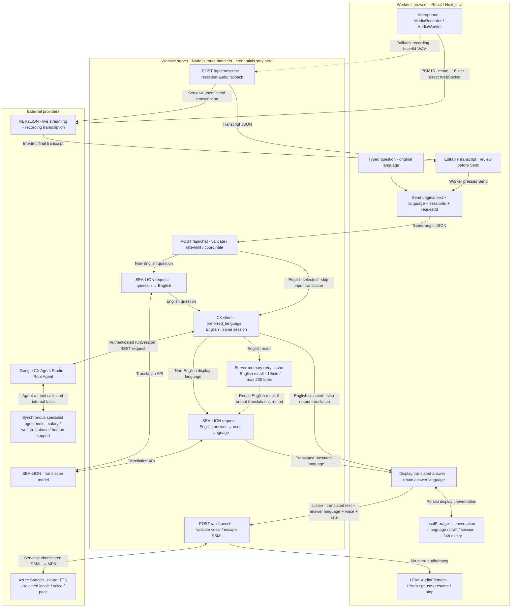

# MDW Compass technical architecture

The browser retains the worker's original text and selected language. MERaLiON converts microphone audio into a transcript. Both typed text and reviewed transcripts enter the same server-side SEA-LION → English CX Agent Studio → SEA-LION pipeline. Azure Speech reads the translated answer aloud only when the worker presses Listen.

## System and data flow



The translation nodes are operations inside `/api/chat`, not separately deployed microservices. MERaLiON's direct live stream uses its optional-key public endpoint; private provider keys are never sent to the browser. Fallback transcription and Azure speech synthesis use server-side credentials.

## Request sequence

```mermaid
sequenceDiagram
  actor Worker
  participant Web as Browser UI
  participant MER as MERaLiON
  participant STT as POST /api/transcribe
  participant Chat as POST /api/chat
  participant SEA as SEA-LION
  participant CX as CX Agent Studio Root
  participant Tools as Specialist agent tools
  participant Speech as POST /api/speech
  participant Azure as Azure Speech

  opt Worker uses microphone
    Worker->>Web: Record in preferred language
    alt Live transcription available
      Web->>MER: Stream mono 16 kHz PCM16 over WebSocket
      MER-->>Web: Interim and final transcript
    else Live transcription fails
      Web->>STT: Recorded audio as base64 WAV
      STT->>MER: Transcription request with server credential
      MER-->>STT: Transcript
      STT-->>Web: Transcript JSON
    end
    Web-->>Worker: Editable transcript for review
  end

  Worker->>Web: Type or review transcript, then Send
  Web->>Chat: Original text, language, sessionId, requestId
  opt Selected language is not English
    Chat->>SEA: Translate question into English
    SEA-->>Chat: English question
  end
  Chat->>CX: runSession; English text; preferred_language=English
  opt Specialist knowledge required
    CX->>Tools: Synchronous agent-as-tool call
    Tools-->>CX: Internal findings
  end
  CX-->>Chat: Root-authored English answer
  Chat->>Chat: Cache English result for bounded retry protection
  opt Selected language is not English
    Chat->>SEA: Translate answer into selected language
    SEA-->>Chat: Translated answer
  end
  Chat-->>Web: Message, language, outputCount
  Web-->>Worker: Display answer
  opt Worker presses Listen
    Worker->>Web: Choose voice / speed and Listen
    Web->>Speech: Answer text, answer language, voice, rate
    Speech->>Azure: Escaped SSML with server credential
    Azure-->>Speech: MP3 audio
    Speech-->>Web: No-store audio/mpeg
    Web-->>Worker: Play audio; pause / resume / stop
  end
```

## Runtime behavior and boundaries

| Boundary | Implemented behavior |
| --- | --- |
| Language onboarding | CX is set to English in the existing session. A neutral greeting is translated into the worker's actual display language. |
| Translation | English selections skip translation. Other selections make two SEA-LION calls. Truncated/empty output and changed ASCII numeric tokens are rejected. These checks do not prove semantic accuracy. |
| Retry | The browser reuses a per-turn request ID. A bounded ten-minute server-memory cache reuses the English CX answer if output translation fails. This protection is not durable across processes, instances or restarts. |
| Playback | Each assistant message retains its language. Two neural voices are configured for each of the twelve menu languages. Default speech uses soft volume and 0.9× pace; no unknown language silently falls back to English. |
| Audio lifecycle | Browser audio stays in memory with up to three cached playback blobs. Stop, language changes, recording and teardown cancel playback or pending loading. |
| Persistence | Original display messages, per-message language, draft and CX session are saved in browser localStorage with a 24-hour inactivity expiry. Audio and API keys are excluded. |
| Provider limits | Server routes validate requests and apply in-memory throttles. Azure synthesis is limited to 20 requests/minute per server instance; the provider enforces resource-wide quotas. |
| Credentials | SEA-LION, fallback MERaLiON, Azure and Google credentials belong in server environment settings. Local `.env.local` is ignored by Git; hosted environments need their own server settings. |

## Source map

| Responsibility | Source |
| --- | --- |
| Browser composer, language and playback controls | [`components/mdw-compass-chat.tsx`](../components/mdw-compass-chat.tsx) |
| Live microphone transcription | [`lib/live-transcription.ts`](../lib/live-transcription.ts) |
| Recorded-audio fallback | [`app/api/transcribe/route.ts`](../app/api/transcribe/route.ts), [`lib/meralion.ts`](../lib/meralion.ts) |
| Translation and English CX orchestration | [`app/api/chat/route.ts`](../app/api/chat/route.ts), [`lib/translated-chat.ts`](../lib/translated-chat.ts) |
| SEA-LION translation client | [`lib/sealion.ts`](../lib/sealion.ts) |
| Google authentication and runSession | [`lib/cx-agent.ts`](../lib/cx-agent.ts), [`lib/google-workload-identity.ts`](../lib/google-workload-identity.ts) |
| Azure synthesis and voice catalog | [`app/api/speech/route.ts`](../app/api/speech/route.ts), [`lib/azure-speech.ts`](../lib/azure-speech.ts), [`lib/speech-languages.ts`](../lib/speech-languages.ts) |
| Cancellable browser audio player | [`lib/speech-player.ts`](../lib/speech-player.ts) |
| Browser session persistence | [`lib/browser-session.ts`](../lib/browser-session.ts) |

## Verification

38 behavior tests, TypeScript, ESLint and production compilation passed during implementation. Live Thai and Mandarin translation, Thai text round trips through CX, all 24 Azure voice mappings and Thai browser playback controls were checked locally. Native-speaker pronunciation and translation quality still need language-specific review. Local verification does not establish a hosted environment's credentials or Azure resource pricing tier.
